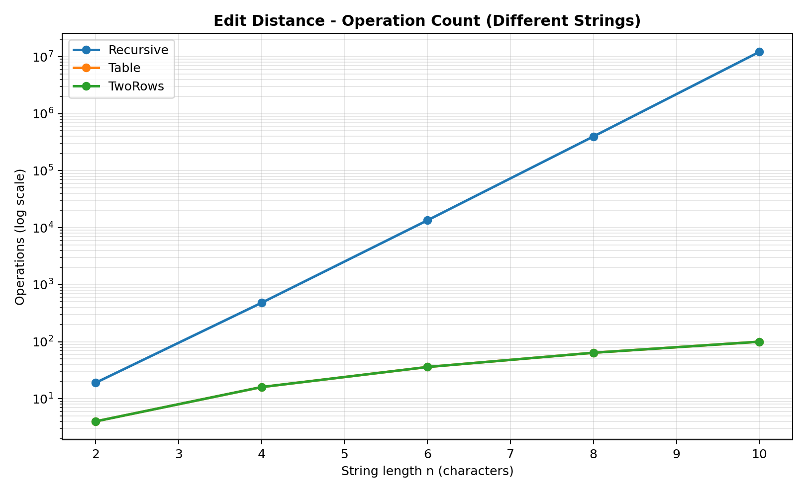
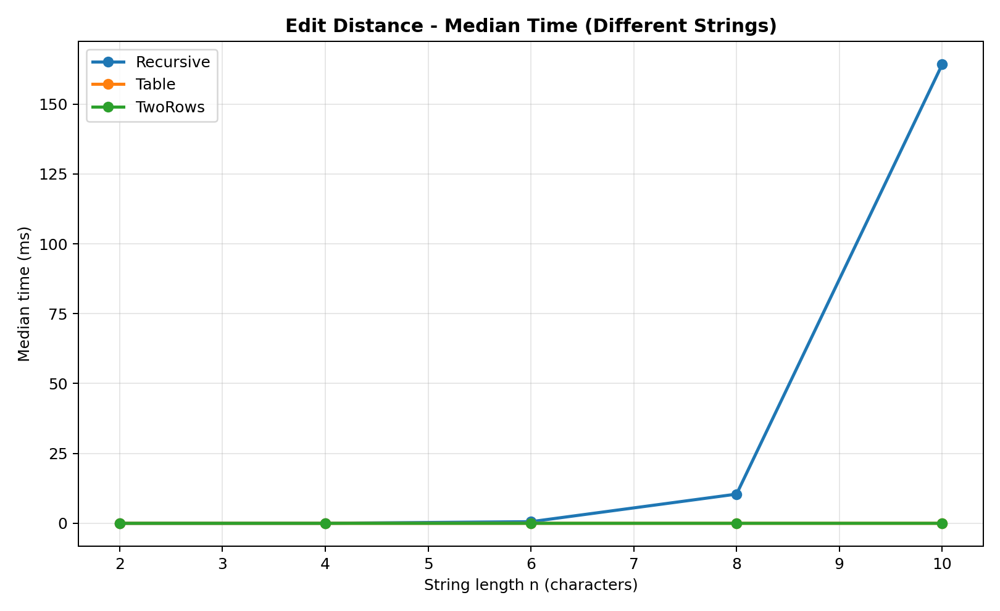
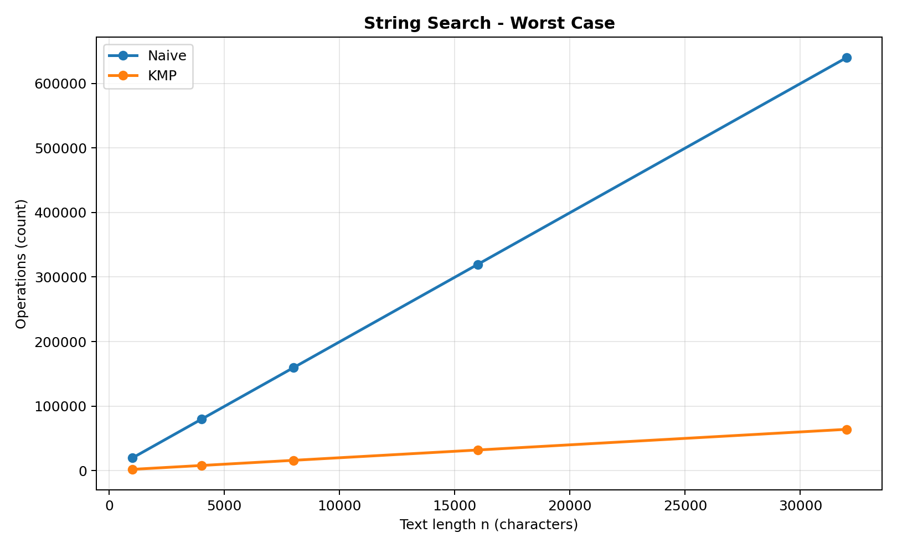

# Assignment 4 — Dynamic Programming and String Algorithms

**Course:** Design and Analysis of Algorithms  
**Project:** City Search & Spell-Check  
**Student:** Urazaliyeva Guldariya  
**Group:** SE-2521

## 1. Experiment Design Card

| Field | Description |
|---|---|
| Question | How does the performance of recursive Edit Distance compare with dynamic programming? How do Naive and KMP perform on random and worst-case inputs? |
| Sizes | Edit Distance: 2, 4, 6, 8, 10 characters. String Search: 1000, 4000, 8000, 16000, 32000 characters. |
| Inputs | Edit Distance uses random strings and completely different strings. String Search uses random text and a special worst-case input with many repeated characters. |
| Metrics | Execution time in milliseconds and number of operations counted inside the algorithms. |
| Prediction | Recursive Edit Distance will become much slower as input size increases. Table and TwoRows will be more efficient. KMP will perform fewer comparisons than Naive on worst-case input. |
| Plots | Edit Distance operation count, Edit Distance execution time, and String Search worst-case operation count. |

The experiment uses a fixed random seed of 42 to generate reproducible input strings. Each test case is executed five times, and the median execution time is used for the plots.

## 2. Algorithms

### Edit Distance

I implemented three versions of Edit Distance.

**Recursive:** This version uses direct recursion without storing previous results. It is easy to understand, but it repeats many calculations.

**Table:** This version uses dynamic programming with a two-dimensional table. It stores intermediate results to avoid repeating calculations. Its time complexity is O(n × m), and its extra space complexity is O(n × m).

**TwoRows:** This version also uses dynamic programming, but stores only the previous and current rows. Its time complexity is O(n × m), while its extra space complexity is O(min(n, m)) in my implementation.

### String Search

**Naive:** This algorithm checks the pattern at every possible position in the text. It is simple, but it can repeat many character comparisons.

**KMP:** This algorithm uses an LPS array to avoid unnecessary comparisons. It processes the text without moving backwards and can find overlapping matches.

## 3. Experimental Results

### Plot 1 — Edit Distance Operations

**Observation:** Recursive Edit Distance grows very quickly, while Table and TwoRows use significantly fewer operations.

For strings of length 10 with completely different characters:

| Algorithm | Operations |
|---|---:|
| Recursive | 12,146,179 |
| Table | 100 |
| TwoRows | 100 |

This result shows why dynamic programming is useful. The recursive algorithm calculates the same subproblems many times, but dynamic programming avoids this problem.

### Plot 2 — Edit Distance Execution Time

**Observation:** Recursive Edit Distance becomes much slower when the string length increases.

For completely different strings of length 10, the median execution times were:

| Algorithm | Median time (ms) |
|---|---:|
| Recursive | 164.1725 |
| Table | 0.0096 |
| TwoRows | 0.0076 |

Both dynamic programming versions were much faster than recursion for this input.

### Plot 3 — String Search Worst Case

**Observation:** KMP performs much fewer counted operations than Naive on the worst-case input.

For a text length of 32,000 characters:

| Algorithm | Operations |
|---|---:|
| Naive | 639,620 |
| KMP | 64,018 |

The Naive algorithm repeatedly compares almost the entire pattern. KMP uses the LPS array to avoid these repeated comparisons.

## 4. Prediction vs Result

### Edit Distance

I expected the recursive version to become slower because it does not save previous results. The experiment confirmed this prediction. For completely different strings of length 10, recursion needed more than 12 million calls, while each dynamic programming version processed only 100 table cells. Table and TwoRows had the same operation count because they use the same DP transition.

### String Search

I expected KMP to be better on the worst-case input. The results confirmed this prediction because KMP performed fewer counted operations than Naive. On random input, the difference was smaller, and Naive was sometimes faster in actual execution time. This is because Naive can stop comparing characters early when there is a mismatch.

## 5. Short Answers

### 1. Which input made string search slowest, and why?

The worst-case input was the most difficult for Naive search in terms of character comparisons. The text contained only the character 'a', while the pattern contained 19 'a' characters followed by 'b'. Naive checked almost the whole pattern at every possible position. KMP avoided many repeated comparisons by using its LPS array.

### 2. How large an n could recursive Edit Distance handle, and what stopped it?

In my experiment, I tested recursive Edit Distance up to n = 10. At this size, the worst-case input required 12,146,179 recursive calls. It still finished, but the number of calls was already very large. I stopped at n = 10 because larger inputs would require much more time.

### 3. What do you gain and lose with TwoRows instead of the full table?

The main advantage of TwoRows is lower memory usage. Instead of storing the complete DP table, it stores only two rows. It still calculates the same Edit Distance result and has the same time complexity. However, it does not keep the complete table, so reconstructing the exact sequence of edits becomes less convenient.

### 4. Which string search algorithm would you choose for the city platform?

I would choose KMP for searching long text files. It avoids repeated comparisons and has O(n + m) time complexity, including LPS construction. Naive is easier to implement and can work well for small inputs. However, KMP gives more predictable performance when the text is large or contains repeated characters.

## 6. Execution Time Discussion

Execution time depends on the computer, Java Virtual Machine, and other programs running in the background. Some measured times did not increase smoothly when the input size increased. This can happen because of JIT compilation, JVM warm-up, and system activity. For this reason, I used the median of five runs and also counted operations inside the algorithms. Operation counts helped me understand algorithm behavior more clearly than time alone.

## 7. Testing

I used JUnit 5 to test the algorithms. All seven test methods passed successfully. The tests included reference values, empty strings, overlapping matches, LPS arrays, and 100 random cases for each algorithm family.

## 8. Conclusion

In this assignment, I compared three Edit Distance implementations and two string search algorithms. The experiments showed that dynamic programming is much more efficient than plain recursion for Edit Distance. The TwoRows version also reduces memory usage compared with the full table.

For string searching, KMP performed fewer operations than Naive on difficult repeated-character inputs. I learned that choosing suitable test inputs and counting operations are important when comparing algorithms.